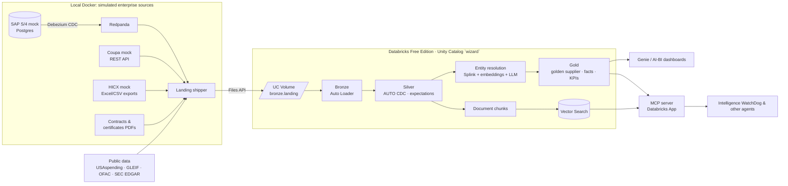

# Databricks Wizard: Supplier 360 on a governed lakehouse

Databricks Wizard is an enterprise AI data foundation built on Databricks. It ingests supplier data from ERP, procurement, supplier-management and document systems, resolves it into one governed **golden supplier record**, and gives analysts, BI tools and AI agents the same set of trusted, traceable datasets.

The core problem is one every procurement team has: the same supplier appears as `IBM Corp` in SAP, `I.B.M.` in Coupa and `International Business Machines` in federal spend data. Until those records are resolved, spend, risk and performance figures are wrong. Databricks Wizard fixes that at the data layer, then builds analytics and AI on top.

## Questions Databricks Wizard answers

| Business question | Answered from |
|---|---|
| Which suppliers have deteriorating delivery performance? | `gold.supplier_kpi_monthly` (on-time %, lead-time trend) |
| Which suppliers have elevated financial or compliance risk? | `gold.supplier_risk_score` (sanctions, SEC filings, certificate expiry, concentration) |
| What is our category-level spend concentration? | `gold.spend_concentration` (HHI, top-N share per category) |
| Which suppliers have incomplete or inconsistent master data? | `gold.supplier_dq_scorecard` and the entity-resolution review queue |
| What happens if we consolidate spend across selected suppliers? | `simulate_consolidation` MCP tool over gold facts |

Each answer can be traced from the gold metric to the silver records, then to the source system row or source PDF, using Unity Catalog lineage.

## Architecture at a glance



More detail:

- [Architecture](docs/architecture.md)
- [Data model](docs/data-model.md)
- [Roadmap](docs/roadmap.md)
- [Architecture decision records](docs/adr/)

## Tech stack

| Layer | Technology |
|---|---|
| Source simulation | Docker Compose, Postgres, Debezium, Redpanda, FastAPI |
| Platform | Databricks Free Edition (serverless) |
| Storage & governance | Delta Lake, Unity Catalog (tags, masks, lineage) |
| Ingestion | Auto Loader, Lakeflow Declarative Pipelines (AUTO CDC) |
| Entity resolution | Splink on Spark, `databricks-gte-large-en` embeddings, `ai_query()` tie-break |
| Orchestration | Lakeflow Jobs |
| AI retrieval | Mosaic AI Vector Search (Delta Sync) |
| Models | Databricks foundation model endpoints (Qwen 3.5, Llama 4 Maverick, GPT-OSS, Llama 3.1 8B) |
| Consumption | Genie, AI/BI dashboards, MCP server on Databricks Apps |
| Delivery | Databricks Asset Bundles, GitHub Actions |

## Budget

The infrastructure budget is ₹0. Everything runs on Docker locally or on Databricks Free Edition, and every design choice respects Free Edition quotas (see [platform constraints](docs/architecture.md#platform-constraints)).

## Repository layout

```
setup/      workspace capability check
scripts/    data download (`make data` → data/raw, not committed)
docs/       architecture, data model, roadmap, ADRs
```

More directories (`sources/`, `pipelines/`, `mcp/`, `bundles/`) are added as each milestone lands.
