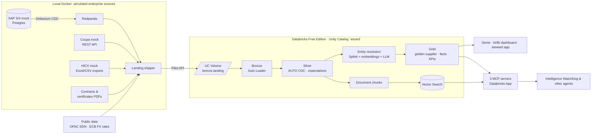

# Databricks Wizard: Supplier 360 on a governed lakehouse

Databricks Wizard is an enterprise AI data foundation built on Databricks. It ingests supplier data from ERP, procurement, supplier-management and document systems, resolves it into one governed **golden supplier record**, and gives analysts, BI tools and AI agents the same set of trusted, traceable datasets.

The core problem is one every procurement team has: the same supplier appears as `ТОВ "АФІНА-КОН"` in a regional SAP company code, `AFINA-KON, LTD` in Coupa and `AFINA-KON, TOV` in the supplier portal. Until those records are resolved, spend, risk and performance figures are wrong. Databricks Wizard fixes that at the data layer, then builds analytics and AI on top.

## Questions Databricks Wizard answers

| Business question | Answered from |
|---|---|
| Which suppliers have deteriorating delivery performance? | `gold.supplier_kpi_monthly` (on-time %, lead-time trend) |
| Which suppliers have elevated financial or compliance risk? | `gold.supplier_risk_score` (sanctions alerts, certificate expiry from the documents, data quality) |
| What is our category-level spend concentration? | `gold.spend_concentration` (HHI, top-N share per category) |
| Which suppliers have incomplete or inconsistent master data? | `gold.supplier_dq_scorecard` and the entity-resolution review queue |
| What happens if we consolidate spend across selected suppliers? | `simulate_consolidation` MCP tool over gold facts |

Each answer can be traced from the gold metric to the silver records, then to the source system row or source PDF, using Unity Catalog lineage.

## Architecture at a glance



More detail:

- [Write-up: how it was built and what it taught](docs/writeup.md)
- [Business case](docs/business-case.md)
- [Architecture](docs/architecture.md)
- [Data model](docs/data-model.md)
- [Roadmap](docs/roadmap.md)
- [Architecture decision records](docs/adr/)

## Tech stack

| Layer | Technology |
|---|---|
| Source simulation | Docker Compose, Postgres, Debezium, Redpanda, FastAPI |
| Platform | Databricks Free Edition (serverless) |
| Storage & governance | Delta Lake, Unity Catalog (tags, masks, lineage) |
| Ingestion | Auto Loader, Lakeflow Declarative Pipelines (AUTO CDC) |
| Entity resolution | Splink (DuckDB backend) in a serverless job, `qwen3-embedding-0-6b` name embeddings, Qwen3-Next 80B adjudication of the uncertain band |
| Orchestration | Lakeflow Jobs |
| AI retrieval | Mosaic AI Vector Search (Delta Sync) |
| Models | Databricks foundation model endpoints, chosen by benchmark ([ADR 0005](docs/adr/0005-model-selection-by-benchmark.md)): Qwen3-Next 80B (ER, agents), Llama 4 Maverick (document extraction), Qwen3 embedding 0.6B |
| Consumption | Genie, AI/BI dashboard, steward app and MCP servers on Databricks Apps |
| Delivery | Databricks Asset Bundles, GitHub Actions |

## Budget

The infrastructure budget is ₹0. Everything runs on Docker locally or on Databricks Free Edition, and every design choice respects Free Edition quotas (see [platform constraints](docs/architecture.md#platform-constraints)).

## Repository layout

```
setup/      workspace capability check
sources/    simulated SAP, Coupa, HICX and document sources + generator (M1)
docker/     local stack: Postgres, Redpanda, Debezium, console, Coupa API
shipper/    landing shipper: local sources -> UC volume, with manifests (M2)
pipelines/  Lakeflow pipelines (bronze, silver, gold) and the semantic layer (metric views)
er/         entity resolution package + Databricks job (M4)
jobs/       small job tasks (vector index sync)
dashboards/ AI/BI dashboard definition (M5)
apps/       Databricks Apps: MCP servers (mcp/) and the steward workbench (steward/)
agents/     agent harness and tool-calling benchmark (M7)
resources/  Asset Bundle resources (pipeline, ingest job, apps, dashboard); bundle root is databricks.yml
scripts/    data download, workspace setup, evals and checks
docs/       write-up, business case, architecture, data model, roadmap, ADRs, case study
```

## Data sources and attribution

Raw data is never committed; `make data` downloads it (`scripts/fetch_data.sh`). Larkspur Foods and its documents are fictional. Supplier names come from public procurement records. Sanctions near-matches are planted only on fictional suppliers, and screening alerts on real names are labelled "pending review", never "sanctioned" ([ADR 0003](docs/adr/0003-real-public-plus-synthetic-data.md)).

| Dataset | Licence | Used for |
|---|---|---|
| [SAP DATASET](https://www.kaggle.com/datasets/mustafakeser4/sap-dataset-bigquery-dataset) by mustafakeser4 (copy of Google's `cloud-training-demos.SAP_REPLICATED_DATA`) | MIT | SAP vendor master and purchasing tables |
| [Polish public tenders](https://www.kaggle.com/datasets/michalpozoga/polish-public-tenders) by Michał Pożoga | CC BY 4.0 | Polish suppliers (company code PL01); names and NIP used as published, sampled |
| [ProZorro public procurement](https://www.kaggle.com/datasets/oleksastepaniuk/prozorro-public-procurement-dataset) by Oleksa Stepaniuk | CC0 | Ukrainian suppliers in Cyrillic (UA01) |
| [World Bank corporate procurement contract awards](https://www.kaggle.com/datasets/theworldbank/corporate-procurement-contract-awards) | CC0 | International indirect-spend vendors |
| [Amazon ML Challenge 2026 mirror](https://www.kaggle.com/datasets/satwiksps/amazon-ml-challenge-2026) by satwiksps | MIT (as stated by the mirror) | External entity-resolution benchmark only |
| [ECB euro foreign exchange reference rates](https://www.ecb.europa.eu/stats/policy_and_exchange_rates/euro_reference_exchange_rates/html/index.en.html) | Free reuse, source acknowledged | Monthly FX rates to USD (`gold.dim_fx`) |
| [World Bank corporate procurement awards, live (Finances One DS00028)](https://financesone.worldbank.org/corporate-procurement-contract-awards/DS00028) | CC BY 4.0 | Optional live snapshot (`scripts/fetch_worldbank_live.py`); builds use the pinned Kaggle copy by default |
| [OFAC SDN list](https://ofac.treasury.gov/specially-designated-nationals-and-blocked-persons-list-sdn-human-readable-lists) | US government work (public domain) | Sanctions screening (names, aliases, addresses) |
| [Company Documents Dataset](https://www.kaggle.com/datasets/ayoubcherguelaine/company-documents-dataset), [Procurement Invoice Fraud](https://www.kaggle.com/datasets/tokelomashile2/procurement-invoice-fraud-dataset) | Apache-2.0 | Downloaded for reference; not used in outputs |
| [Supply Chain Datasets](https://www.kaggle.com/datasets/ayodejiibrahimlateef/supply-chain-datasets) | CC BY 4.0 | Downloaded for reference; not used in outputs |
| [Olist](https://www.kaggle.com/datasets/olistbr/brazilian-ecommerce) | CC BY-NC-SA 4.0 | Not used (no rows republished) |
