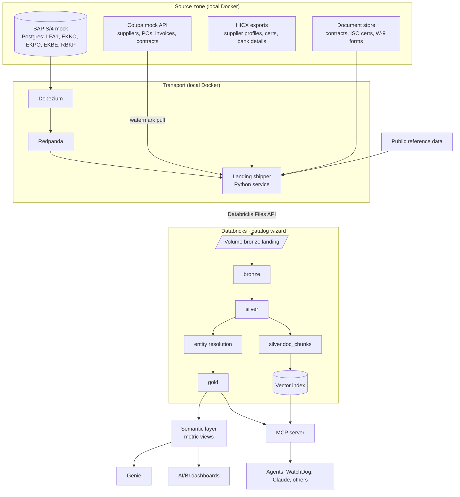
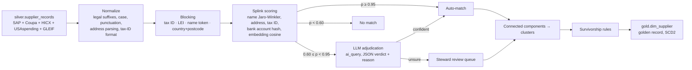

# Architecture

## 1. Design goals

1. **One version of each supplier.** Every downstream number is keyed on a resolved `supplier_id`, never on a source-system vendor ID.
2. **Traceable answers.** Any figure an agent or dashboard shows can be traced back to a source row or document.
3. **Governed by default.** Access control, PII masking, tags and lineage live in Unity Catalog, not in application code.
4. **Same data for people and agents.** Genie, dashboards and MCP tools read the same gold tables and metric definitions.
5. **₹0 to run.** The design fits Databricks Free Edition quotas and local Docker.

## 2. System context



### Why there is a shipper

Databricks Free Edition cannot reach into a laptop, so ingestion is push-based. Local extractors write micro-batches of change events and API pages as JSON or Parquet files, then upload them to a Unity Catalog Volume. Enterprises do the same with landing zones (S3/ADLS drops from on-prem agents), so the pattern is realistic, not just a workaround. See [ADR 0002](adr/0002-hybrid-local-sources-push-landing.md).

Landing layout:

```
/Volumes/wizard/bronze/landing/
  sap/cdc/<table>/<yyyy-mm-dd>/<batch>.json      # Debezium envelopes
  coupa/<entity>/<yyyy-mm-dd>/<page>.json         # API pages, watermark in manifest
  hicx/<export_date>/<file>.xlsx|csv
  docs/<supplier_ref>/<doc_type>/<file>.pdf
  public/<dataset>/<snapshot_date>/...
  _manifests/<source>/<batch>.json                # row counts, checksums, watermark
```

Each batch has a manifest, so bronze can reconcile what arrived against what was sent. That reconciliation is the first data-quality check.

## 3. Medallion layers

| Layer | Contract | Built with |
|---|---|---|
| **Bronze** | Append-only, schema-on-read, plus ingest metadata (`_source`, `_file`, `_ingested_at`, `_batch_id`). Never edited. | Auto Loader streaming tables in a Lakeflow Declarative Pipeline |
| **Silver** | Typed, deduplicated, conformed to a canonical model. CDC applied. Bad rows quarantined, not dropped. | `AUTO CDC` (SCD1 for transactions, SCD2 for vendor master), expectations, quarantine tables |
| **Entity resolution** | Clusters of source records that refer to one real supplier, with match scores and explanations. | Splink (Fellegi–Sunter) + embedding similarity + `ai_query()` for the uncertain middle band |
| **Gold** | Business-ready, keyed on `supplier_id`. Facts, dimensions, KPIs, risk. | Materialized views / jobs |

### Data-quality approach

- **Expectations** in pipelines: `expect` (warn), `expect_or_drop` (send to quarantine), `expect_or_fail` (for broken contracts, e.g. a manifest count mismatch).
- **Quarantine tables** (`silver._quarantine_<entity>`) keep rejected rows and the rule that rejected them, so the data steward has something to act on.
- **DQ scorecard** (`gold.supplier_dq_scorecard`): completeness, validity and consistency per supplier and per source. This feeds the "incomplete or inconsistent master data" question.

## 4. Entity resolution (the core of the project)



- **Deterministic first.** Exact tax-ID or LEI matches are auto-linked before anything probabilistic runs.
- **Survivorship** is field-level and documented. Example: legal name comes from GLEIF, then HICX, then SAP. Bank details come only from HICX (verified). Address uses the most recently updated trusted source.
- **Explainability.** `gold.supplier_match_evidence` stores every link with its score, the comparison levels that fired and, where used, the LLM's reason. The MCP tool `explain_supplier_match` reads from it.
- Evaluation uses a labelled set generated with the synthetic data (the injected duplicates are known), so precision and recall are measured, not guessed.

Details are in [ADR 0004](adr/0004-entity-resolution-approach.md).

## 5. Knowledge layer (documents)

1. PDFs land in `bronze.landing/docs/`, and a binary-file bronze table records path, hash and metadata.
2. Parsing: `ai_parse_document()` if it is available on Free Edition. Otherwise `llama-4-maverick` via `ai_query()` on page images for scans, and `pypdf` for text PDFs.
3. Structured extraction with `ai_query()` and a JSON schema: certificate type, issuer, expiry date, contract value, payment terms, termination clauses.
4. Chunks in `silver.doc_chunks` carry `supplier_id`, `doc_id`, `page` and `chunk_id`, so every retrieved passage links back to a governed supplier and a page.
5. Delta Sync vector index `wizard.silver.doc_chunks_idx` on the single Free Edition endpoint `wizard-vs`, using `databricks-gte-large-en` embeddings.

Extracted fields such as certificate expiry go into gold risk features. So the documents are more than RAG context: they feed the numbers too.

## 6. Semantic and consumption layer

| Consumer | Interface | Notes |
|---|---|---|
| Analysts | Genie space "Supplier 360" | Curated tables, instructions, example SQL, trusted-asset queries |
| Executives | AI/BI dashboard | Spend concentration, delivery trends, risk heat map, DQ scorecard |
| Agents | MCP server (Databricks App) | Read-only tools over gold tables and the vector index |
| WatchDog | MCP client | Gets supplier context during process-intelligence investigations |

KPI definitions (on-time delivery %, spend HHI, risk score) are defined once, as Unity Catalog metric views if Free Edition supports them, otherwise as governed SQL views. Genie, dashboards and MCP all read those definitions.

### MCP tools

| Tool | Purpose |
|---|---|
| `search_suppliers(query)` | Fuzzy and semantic lookup returning `supplier_id`s |
| `get_supplier_360(supplier_id)` | Golden record, KPIs, risk, DQ, source-system IDs |
| `get_kpi(metric, filters)` | Governed metric query; returns the value and the SQL that produced it |
| `trace_metric(metric, supplier_id)` | Lineage: gold → silver → source rows/docs |
| `search_documents(query, supplier_id?)` | Vector search with page-level citations |
| `explain_supplier_match(supplier_id)` | Entity-resolution evidence |
| `simulate_consolidation(supplier_ids, category)` | What-if spend consolidation (stretch goal) |

All tools are read-only and run under a service principal that only has `SELECT` on gold and the index. Agents cannot reach bronze or raw PII.

## 7. Governance

- **Catalog layout:** `wizard.bronze`, `wizard.silver`, `wizard.gold`, plus `wizard.ops` for manifests, run logs and eval results.
- **Tags:** `pii`, `source_system`, `data_owner`, `certified` on tables and columns.
- **Column masks:** bank account and tax ID are masked unless the user is in `wizard_stewards`.
- **Row filters:** optional demo of category-manager scoping (each manager sees only their categories).
- **Lineage:** Unity Catalog system tables (`system.access.table_lineage`, `column_lineage`) power `trace_metric`.
- **Groups:** `wizard_engineers`, `wizard_stewards`, `wizard_analysts`, and the `wizard_agent` service principal.

See [ADR 0007](adr/0007-governance-model.md).

## 8. Orchestration and delivery

- **Lakeflow Jobs:** `ingest` (pipeline update) → `entity_resolution` → `gold_refresh` → `doc_index_sync` → `dq_report`. Kept to ≤5 concurrent tasks (Free Edition limit).
- **Databricks Asset Bundles** describe pipelines, jobs, the app and permissions as code, with `dev` and `prod` targets in separate schemas or catalogs.
- **GitHub Actions:** lint and unit tests (pytest + chispa on local Spark) → `bundle validate` → `bundle deploy -t dev` → smoke-test job.

## 9. Platform constraints

Checked against the workspace on 2026-11-13 with `setup/00_capability_check.py`:

| Capability | Result | Design response |
|---|---|---|
| Create catalog `wizard`, schemas, volumes | ✅ | Use `wizard` catalog |
| Delta CDF, time travel | ✅ | CDF on silver for incremental gold |
| Auto Loader on serverless | ✅ | Bronze ingestion |
| Lakeflow pipelines, Jobs, Apps, Genie APIs | ✅ | All in scope |
| Foundation models, `ai_query()` | ✅ | See [ADR 0005](adr/0005-model-selection-by-benchmark.md) |
| Vector Search | ✅ (1 endpoint, 1 unit) | One endpoint `wizard-vs`, Delta Sync indexes only |
| System lineage/billing tables | ✅ exist, 0 rows on day 1 | Re-check after propagation delay |
| Apps | max 3, stop after 24h | MCP server + one spare; restart before demos |
| Jobs | max 5 concurrent tasks | Narrow DAGs |
| Compute | Serverless only, Python/SQL only | No Scala; Splink via pip on serverless |

**Still to verify:** outbound internet from serverless (decides whether public data is fetched in Databricks or by the shipper), `ai_parse_document()` availability, metric views availability, and Splink installing on serverless.
