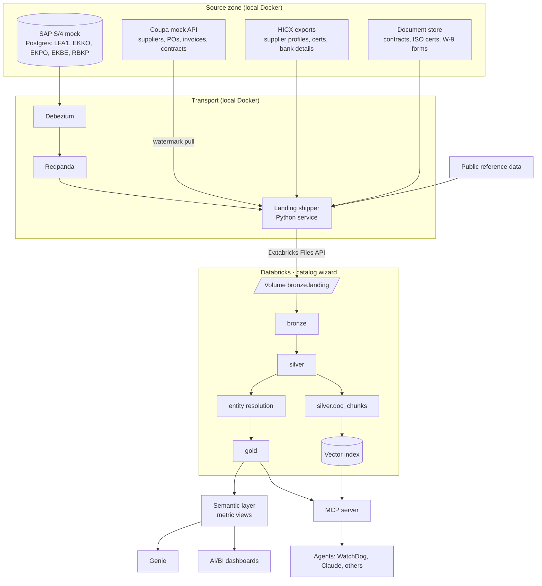
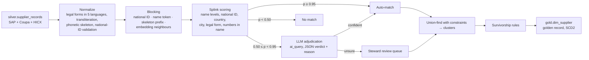
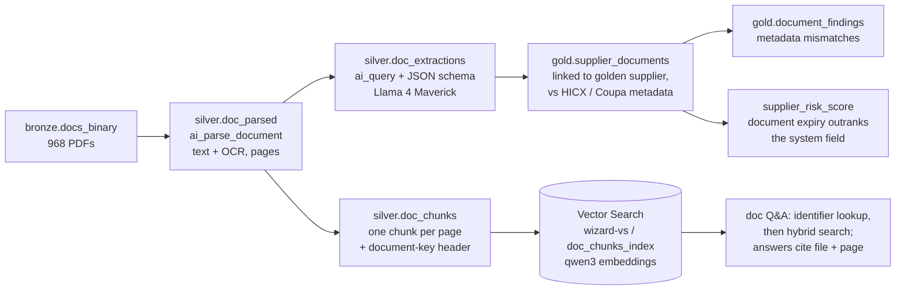

# Architecture

## 1. Design goals

1. **One version of each supplier.** Every downstream number is keyed on a resolved `supplier_id`, never on a source-system vendor ID.
2. **Traceable answers.** Any figure an agent or dashboard shows can be traced back to a source row or document.
3. **Governed by default.** Access control, PII masking, tags and lineage live in Unity Catalog, not in application code.
4. **Same data for people and agents.** Genie, dashboards and MCP tools read the same gold tables and metric definitions.
5. **₹0 to run.** The design fits Databricks Free Edition quotas and local Docker.

## 2. System context



### Why there is a shipper

Databricks Free Edition cannot reach into a laptop, so ingestion is push-based. Local extractors write micro-batches of change events and API pages as JSON or Parquet files, then upload them to a Unity Catalog Volume. Enterprises do the same with landing zones (S3/ADLS drops from on-prem agents), so the pattern is realistic, not just a workaround. See [ADR 0002](adr/0002-hybrid-local-sources-push-landing.md).

Landing layout:

```
/Volumes/wizard/bronze/landing/
  sap/cdc/<table>/<yyyy-mm-dd>/<batch>.json      # Debezium envelopes
  coupa/<entity>/<yyyy-mm-dd>/<page>.json         # API pages, watermark in manifest
  hicx/<export_date>/<file>.xlsx|csv
  docs/<supplier_ref>/<doc_type>/<file>.pdf
  public/<dataset>/<snapshot_date>/...
  _manifests/<source>/<batch>.json                # row counts, checksums, watermark
```

Each batch has a manifest, so bronze can reconcile what arrived against what was sent. That reconciliation is the first data-quality check (`bronze.landing_reconciliation`, one row per file with status `OK`, `MISMATCH`, `NOT_LOADED` or `NO_MANIFEST`).

**Delivery guarantees.** The shipper writes data files first and the manifest last, and only then commits Kafka offsets or advances Coupa watermarks. A crash can therefore re-send data (at-least-once) but never lose it. Silver deduplicates SAP events on `(kafka_topic, kafka_partition, kafka_offset)` and Coupa records on `(id, updated-at)`; Coupa pulls also re-read a 60-second overlap window on purpose.

**Triggering.** The `wizard-ingest` job has a file-arrival trigger on `_manifests/`, so every completed batch starts a pipeline update with no manual step. Free Edition requires the trigger's wait-after-last-change to be over 60 s (set to 75 s), so end-to-end latency from a Postgres commit to bronze is typically 3–5 minutes.

## 3. Medallion layers

| Layer | Contract | Built with |
|---|---|---|
| **Bronze** | Append-only, schema-on-read, plus ingest metadata (`_file`, `_batch_id`, `_ingested_at`). Never edited. SAP CDC events and Coupa records are stored whole as `VARIANT` (`payload`), so upstream schema changes never break ingestion; CSVs land as string columns, xlsx and PDFs as binary. | Auto Loader streaming tables in a Lakeflow Declarative Pipeline (`pipelines/bronze.py`) |
| **Silver** | Typed, deduplicated, conformed to a canonical model. CDC applied in sequence order (source LSN, Kafka offset), so late and out-of-order events land correctly. Bad rows quarantined, not dropped. | `AUTO CDC` (SCD1 for transactions, SCD2 for vendor master), hard rules → `dq_quarantine`, soft rules → `dq_findings` / `dq_summary` (`pipelines/silver.py`) |
| **Entity resolution** | Clusters of source records that refer to one real supplier, with match scores and explanations. | Splink (Fellegi–Sunter) + embedding similarity + `ai_query()` for the uncertain middle band |
| **Gold** | Business-ready, keyed on `supplier_id`. Facts, dimensions, KPIs, risk. | Materialized views / jobs |

### Data-quality approach

- **Expectations** in pipelines: `expect` (warn), `expect_or_drop` (send to quarantine), `expect_or_fail` (for broken contracts, e.g. a manifest count mismatch).
- **Quarantine** (`silver.dq_quarantine`, one shared table fed by an append flow per entity) keeps rejected rows as JSON with the rules they failed, so the data steward has something to act on. One table instead of one per entity keeps silver inside the Free Edition table quota.
- **DQ scorecard** (`gold.supplier_dq_scorecard`): completeness, validity and consistency per supplier and per source. This feeds the "incomplete or inconsistent master data" question.

## 4. Entity resolution (the core of the project)



- **Deterministic first.** Equal valid national IDs, and exact normalized names in the same country with nothing contradicting, are linked before anything probabilistic runs.
- **Survivorship** is field-level and documented: legal name HICX, then SAP, then Coupa; national ID from validated sources only; the local-script name is kept. Bank details come only from HICX. Every version of the golden record is kept in `gold.dim_supplier_history` (SCD2).
- **Explainability.** `gold.supplier_match_evidence` stores every link with its score, the comparison levels that fired and, where used, the LLM's reason. The MCP tool `explain_supplier_match` reads from it.
- Evaluation uses a labelled set generated with the synthetic data (the injected duplicates are known), so precision and recall are measured, not guessed.

Details are in [ADR 0004](adr/0004-entity-resolution-approach.md), including what the implementation changed from this plan (exact-name tier, cluster constraints, embedding neighbours instead of raw vectors in Splink, the LLM ambiguity guard) and the measured results: pairwise F1 0.968 overall, 0.972 Cyrillic–Latin. The job runs as the third task of `wizard-ingest` (bronze → silver → entity resolution) in about 2 minutes.

## 5. Knowledge layer (documents)



- **Parsing:** `ai_parse_document` (available on Free Edition) handles text PDFs and the scanned certificates (OCR) in one SQL function; parsed once per document in a streaming table. OCR shows a realistic quirk: Cyrillic letters read as Latin look-alikes (`ТОВ "РОМА"` → `TOB "POMA"`).
- **Extraction:** one JSON schema per document type, every field required but nullable (an early test showed a model dropping the expiry date when fields were optional; another swapped customer and supplier until the prompt named the parties). Model chosen by benchmark (ADR 0005 benchmark 3): Llama 4 Maverick, 0.999 field accuracy, 1.000 on scanned certificates.
- **Reconciliation:** document fields vs the system of record, joined by the key in the file path (never by the extracted number). Finds all 28 planted mismatches with no false positives. Certificate expiry from the document feeds compliance risk.
- **Retrieval:** page-level chunks with a document-key header (element-level chunks split a clause heading from its text). Questions naming a document key are answered by exact lookup first, because embeddings treat `CTR-00247` and `CTR-00248` as near-identical; otherwise hybrid (keyword + vector) search. Answers come only from retrieved chunks and cite `[file, page]`; when the sources don't contain the answer the model says so.
- **Exit test** (`scripts/m6_rag_eval.py`): 40 questions from the document answer key (incl. 10 without a document number): retrieval, answer and citation all 40/40.
- Free Edition: one Vector Search endpoint. A Delta Sync index cannot follow a source that was fully overwritten; after a full refresh of `doc_chunks`, recreate the index (`scripts/vector_search_setup.py` is idempotent).

## 6. Semantic and consumption layer

| Consumer | Interface | Notes |
|---|---|---|
| Analysts | Genie space "Supplier 360" | Curated tables, instructions, example SQL, trusted-asset queries |
| Executives | AI/BI dashboard | Spend concentration, delivery trends, risk heat map, DQ scorecard |
| Agents | MCP server (Databricks App) | Read-only tools over gold tables and the vector index |
| WatchDog | MCP client | Gets supplier context during process-intelligence investigations |

KPI definitions are defined once as **Unity Catalog metric views** (supported on Free Edition): `gold.metrics_spend`, `gold.metrics_delivery`, `gold.metrics_supplier` (`pipelines/semantic_layer.sql`, run as the last task of `wizard-ingest`). Genie, the dashboard and (in M7) MCP tools read them. Join aliases avoid `source`, because the fact tables have a `source` column that collides with the metric view's own alias; joins use `using:`.

- **Genie space** "Supplier 360" (`scripts/genie_space.py`, created through the REST API because the pinned SDK has no create call): gold tables + metric views + instructions that pin the business definitions (deterioration, risk bands, alerts ≠ findings, no financial risk).
- **AI/BI dashboard** as code (`dashboards/supplier360.lvdash.json`, deployed by the bundle): headline KPIs, spend and concentration, market on-time trend, deteriorating suppliers, risk watchlist, master-data issues.
- **Exit test:** `scripts/m5_genie_eval.py` asks Genie the four core questions, runs its SQL and scores the answers against gold. 4/4 pass.

### MCP servers

Three MCP servers in one Databricks App, mirroring WatchDog: `/analytics/mcp`, `/knowledge/mcp`, `/stewardship/mcp`.
Tools, conventions and the approval flow: [ADR 0006](adr/0006-mcp-as-agent-interface.md). Every tool returns data
plus provenance (SQL run, tables, citations); every call is audited in `ops.agent_tool_calls`.

## 7. Governance

- **Catalog layout:** `wizard.bronze`, `wizard.silver`, `wizard.gold`, plus `wizard.ops` for manifests, run logs and eval results.
- **Tags:** `pii`, `source_system`, `data_owner`, `certified` on tables and columns.
- **Column masks:** bank account (IBAN) and national/tax IDs, in silver and gold, are masked unless the user is in `wizard_stewards` (9 tables, 11 columns).
- **Row filters:** `gold.fact_invoice` is scoped by company code (`wizard_cc_<code>` groups); stewards and analysts see all.
- **Enforcement:** policies are applied by the `governance` job task on every run, and the `health_check` task fails if a `pii`-tagged column is unmasked.
- **Lineage:** Unity Catalog system tables (`system.access.table_lineage`, `column_lineage`) power `trace_metric`.
- **Groups:** `wizard_engineers`, `wizard_stewards`, `wizard_analysts`, and the `wizard_agent` service principal.

See [ADR 0007](adr/0007-governance-model.md).

## 8. Orchestration and delivery

- **Lakeflow Jobs:** one `wizard-ingest` job, triggered when a shipper manifest lands: bronze → silver → (`vector_index_sync` ∥ `entity_resolution`) → gold → `governance` → `semantic_layer` → `health_check`. A failed run emails the owner; the address is a bundle variable kept out of the repo (local `variable-overrides.json`, CI secret).
- **Databricks Asset Bundles** describe the pipelines, job, both apps, the dashboard and their permissions as code. There is one deployment, kept in the `wizard-ci` service principal's home folder. The `dev` target (a person, CLI profile) and the `ci` target (GitHub Actions) both deploy to it, so they update the same resources instead of creating copies.
- **GitHub Actions:** ruff and per-package pytest → `bundle validate` → `bundle plan` → `bundle deploy` (pushes to main only). It authenticates as the `wizard-ci` service principal with OAuth M2M; there are no personal tokens. The service principal has CAN_MANAGE on the bundle's resources (granted once by `scripts/grant_ci_sp.sh`) and nothing else. The bundle deliberately declares no `permissions`. When it does, the CLI makes the deploying identity the owner of every job and pipeline, which only an admin may do and which would change who they run as. Without them, jobs and pipelines keep their owner and run-as identity, so CI can change the code but not the identity it runs under. If a deploy would delete or recreate a resource, it stops in CI, because destructive changes need a person to approve them.
- **Version pin:** the CLI in CI (`setup-cli@v1.23.0`) matches the one that wrote the deployment state. An older CLI uses the Terraform engine and would not see the deployed resources.

## 9. Platform constraints

Checked against the workspace on 2026-11-13 with `setup/00_capability_check.py`:

| Capability | Result | Design response |
|---|---|---|
| Create catalog `wizard`, schemas, volumes | ✅ | Use `wizard` catalog |
| Delta CDF, time travel | ✅ | CDF on silver for incremental gold |
| Auto Loader on serverless | ✅ | Bronze ingestion |
| Lakeflow pipelines, Jobs, Apps, Genie APIs | ✅ | All in scope |
| Foundation models, `ai_query()` | ✅ | See [ADR 0005](adr/0005-model-selection-by-benchmark.md) |
| Vector Search | ✅ (1 endpoint, 1 unit) | One endpoint `wizard-vs`, Delta Sync indexes only |
| System lineage/billing tables | ✅ exist, 0 rows on day 1 | Re-check after propagation delay |
| Apps | max 3, stop after 24h | MCP server + one spare; restart before demos |
| Jobs | max 5 concurrent tasks | Narrow DAGs |
| File-arrival triggers | ✅ on UC volumes; wait-after-last-change must be > 60 s | Ingest job triggered by manifests (75 s wait) |
| `VARIANT` in Lakeflow pipelines | ✅ | Bronze payload columns |
| Tables per schema | **max 100**, and every streaming table / materialized view also creates a hidden `__materialization_…` table, so each pipeline object counts twice | One shared `silver.dq_quarantine` instead of one quarantine table per entity; layers in separate schemas; keep an eye on `information_schema.tables` counts. Removing a table from a pipeline does **not** drop it, and dropping it does **not** drop its hidden `__materialization_…` table; drop both |
| Compute | Serverless only, Python/SQL only | No Scala; Splink via pip on serverless |

Verified since: `ai_parse_document`, metric views and Splink (DuckDB backend) in a serverless job all work. Public data arrives through the shipper, like every other source, so outbound internet from serverless isn't needed.
