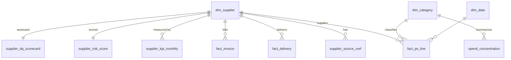

# Data model

All tables live in the `wizard` catalog. Bronze and silver keep source-system names and keys. Gold is keyed on the resolved `supplier_id`.

**The enterprise:** *Larkspur Foods*, a fictional food manufacturer. Direct spend (food ingredients) runs through SAP company codes US01 (USD), NL01 (EUR), PL01 (PLN) and UA01 (UAH). Indirect spend (IT services, MRO, logistics, professional services, facilities) runs through Coupa. How the sources are built and run: [sources/README.md](../sources/README.md).

## Sources

| Source | Simulates | Entities | Delivery mode |
|---|---|---|---|
| SAP S/4 mock | ERP | `LFA1` vendor master, `LFB1` vendor/company code, `EKKO` PO header, `EKPO` PO item, `EKBE` PO history (goods receipts, invoice receipts), `RBKP` invoice header | CDC (Debezium → Redpanda → shipper) |
| Coupa mock | Procure-to-pay | `suppliers`, `purchase_orders`, `invoices`, `contracts` | REST, incremental by `updated_at` watermark |
| HICX mock | Supplier information management | supplier profiles, certifications, bank details, contacts | Weekly Excel/CSV export drop |
| Documents | Contract and compliance repository | contracts, ISO 9001/14001 certificates, W-9-style tax forms | File drop |
| USAspending.gov | Real procurement spend | federal contract awards by recipient (UEI, name, address, NAICS) | Bulk download snapshot |
| GLEIF | Real legal entity reference | LEI, legal name **in local language and script**, transliterated and other names, address, parent relationships | API lookups for in-scope suppliers |
| OFAC SDN | Real sanctions list | sanctioned entities and aliases (many transliterated from Cyrillic and Arabic) | Snapshot |
| SEC EDGAR | Real financial signals | company facts (revenue, net income, filings) | API snapshot for listed suppliers |
| ProZorro (Ukraine) | Regional ERP: Ukrainian operations | real supplier names in **Cyrillic**, EDRPOU company IDs, tender awards (2015–2019) | Kaggle snapshot (CC0), replayed through company code UA01 |
| Polish public tenders (BZP + TED) | Regional ERP: Polish operations | 81,674 real contractors with **Polish diacritics** and NIP, awards (2024–present) | Kaggle snapshot (CC BY 4.0), replayed through company code PL01 |

## Multilingual suppliers

The enterprise has regional operations in **Poland** and **Ukraine**. Their SAP company codes store suppliers the way local buyers type them, while group-level systems (Coupa, HICX) store English or transliterated names. One supplier can therefore appear as:

| System | Name |
|---|---|
| SAP company code UA01 | `ТОВ "Нова Пошта"` |
| Coupa (group) | `Nova Poshta LLC` |
| HICX | `NOVA POSHTA, TOV` |
| GLEIF | legal name in Cyrillic + transliterated name |

Ground truth for cross-script pairs comes from two places: GLEIF records that carry both the local legal name and a transliterated name, and the generator, which writes known variants of each regional supplier into group systems.

Matching problems this adds:

- **Script:** Cyrillic ↔ Latin, with several transliteration standards (`Нова` → `Nova`, `Novа`, `Nowa`)
- **Legal forms in other languages:** `ТОВ`/`TOV` = `Sp. z o.o.` = `LLC` = `GmbH` = `Ltd`
- **Diacritics:** `Łódź` vs `Lodz`, `Spółka` vs `Spolka`
- **Translated vs transliterated names:** `Укрзалізниця` vs `Ukrzaliznytsia` vs `Ukrainian Railways`
- **National IDs:** EDRPOU (UA), NIP/REGON (PL), with country-specific format and checksum validation

The same multilingual matching is used for **sanctions screening**, since many OFAC aliases are transliterations.

## External datasets

Checked via the Kaggle API on 2026-11-13 (licence from dataset metadata; contents profiled where noted). Raw data is never committed. `make data` downloads it.

| Dataset | Licence | What's actually in it | Role | Decision |
|---|---|---|---|---|
| [SAP DATASET](https://www.kaggle.com/datasets/mustafakeser4/sap-dataset-bigquery-dataset) (copy of Google's `cloud-training-demos.SAP_REPLICATED_DATA`) | MIT | ~70 real SAP tables incl. `LFA1`, `EKKO`, `EKPO`, `EKET`, `EKBE`, `RBKP`, `RSEG`, `ADRC`, `T001`, `TCURR`. **Profiled:** 3,035 vendors (US 1,387, DE 979, then CA/CN/NL/FR/JP/IN); demo-style names with natural duplicates (`C.E.B. BERLIN` ×2); 76,362 POs dated 2018-04 to 2022-04, but **only 38 vendors have POs** | SAP S/4 mock: vendor master and document flows | **Use.** Keep real structures and links. Spread POs across the full supplier universe and shift dates to the last 3 years. Skip `dd03l` (1 GB data dictionary) |
| [Amazon ML Challenge 2026 mirror](https://www.kaggle.com/datasets/satwiksps/amazon-ml-challenge-2026) | MIT (as stated by the mirror) | 3 sources (`entity_id`, `business_name`, `business_address`, `country`) plus ground truth. **Profiled:** 2.2M source-1 records, **US 60% / India 40%**, avg 3.5 matches per record, 123k with no match | External benchmark for the matcher | **Use a 50k sample** for internal benchmarking only; never republish. Records are small businesses, not suppliers, so the benchmark tests the matcher rather than the domain |
| [Polish public tenders](https://www.kaggle.com/datasets/michalpozoga/polish-public-tenders) | CC BY 4.0 | **Profiled:** 81,674 contractors with real **NIP**, names with diacritics and legal forms (`Sp. z o.o.`, `SPÓŁKA JAWNA`), inconsistent city casing (`Warszawa`/`WARSZAWA`), win counts and values, 2024–present | Regional PL01 company code | **Use.** Exclude `[Osoba fizyczna]` rows (anonymized private individuals) |
| [ProZorro](https://www.kaggle.com/datasets/oleksastepaniuk/prozorro-public-procurement-dataset) | CC0 | `Suppliers.csv` (1.7 GB), `Competitive_procurements.csv` (1.1 GB), 2015–2019. Not profiled yet | Regional UA01 company code (Cyrillic) | **Use a sample.** Exclude sole proprietors (ФОП), who are private individuals |
| [CUAD](https://www.atticusprojectai.org/cuad) | CC BY 4.0 | The Kaggle entry holds **only a README**. 510 contracts + 13k expert labels are on the Atticus/Zenodo source | Document layer, extraction scoring | **Use, from the original source**, as an extraction benchmark corpus. Supplier contracts are generated from a template so parties match the supplier master |
| [World Bank Corporate Procurement Contract Awards](https://www.kaggle.com/datasets/theworldbank/corporate-procurement-contract-awards) | CC0 | One 0.5 MB CSV, a **stale 2021 snapshot** | Real indirect spend, international vendors | **Use the Kaggle snapshot for now.** The old Socrata API now redirects to the new "Finances One" portal; switching to live data is a later task |
| [Company Documents Dataset](https://www.kaggle.com/datasets/ayoubcherguelaine/company-documents-dataset) | Apache-2.0 | Northwind-based PDFs (invoices, POs, shipping orders, stock reports) | Invoice/PO PDFs | **Use** |
| [Procurement Invoice Fraud Dataset](https://www.kaggle.com/datasets/tokelomashile2/procurement-invoice-fraud-dataset) | Apache-2.0 | Parquet tables, behavioural features, rule-explained fraud labels, invoice PNGs | Invoice-anomaly risk signal; images for the multimodal model | **Use** (stretch) |
| [Supply Chain Datasets](https://www.kaggle.com/datasets/ayodejiibrahimlateef/supply-chain-datasets) | CC BY 4.0 | Supplier master, 200 KB of procurement orders, data dictionary | Seed for the Coupa mock | **Optional** |
| [Olist](https://www.kaggle.com/datasets/olistbr/brazilian-ecommerce) | CC BY-NC-SA 4.0 | 100k orders with promised vs. actual delivery dates | Delivery-delay distributions only (no rows republished) | **Not used.** Real goods-receipt lateness from the SAP data replaced it |

Attribution for every dataset goes in the README.

## Synthetic data and injected defects

The generator (`sources/wizard_sources/`) produces about 3,200 real-world suppliers (5,600+ source records), 73k SAP POs over 4 years, 22k Coupa POs over 3 years, and about 970 documents. Supplier identities come from the SAP demo vendor master, World Bank awardees, Polish tenders and ProZorro. USAspending, GLEIF and SEC enrichment are planned for later milestones.

Defects are injected on purpose and **recorded in a ground-truth table**, so data-quality and entity-resolution results can be scored:

| Defect | Example | Detected by |
|---|---|---|
| Cross-system duplicates | `IBM Corp` (SAP) / `I.B.M.` (Coupa) / `INTERNATIONAL BUSINESS MACHINES CORPORATION` (USAspending) | Entity resolution |
| Within-system duplicates | Two SAP `LIFNR`s for one supplier, created years apart | Entity resolution |
| Name variants | Legal suffixes, abbreviations, typos, transliterations | Normalization + Splink |
| Cross-script variants | `ТОВ "Нова Пошта"` (SAP UA01) / `Nova Poshta LLC` (Coupa) / `Nowa Poszta` (bad transliteration) | Multilingual normalization + embeddings + LLM |
| Invalid national IDs | EDRPOU or NIP with a wrong check digit | Country-specific validation → DQ scorecard |
| Missing or invalid tax IDs | Blank, wrong format, wrong check digit | Expectations → DQ scorecard |
| Conflicting addresses | Different postcode in SAP vs HICX | Survivorship + DQ consistency |
| Delivery drift | A chosen set of suppliers whose on-time rate drops slowly over 9 months | Delivery KPIs |
| Expiring or expired certificates | ISO cert expired but supplier still active | Doc extraction → risk |
| Sanctions hits | Synthetic supplier alias close to an OFAC SDN entry | Sanctions screening |
| Late-arriving and out-of-order CDC | Update events before the insert event | `AUTO CDC` sequencing |
| Schema drift | Coupa adds a field mid-history | Auto Loader schema evolution |

## Bronze

One streaming table per source entity, all with these metadata columns:

| Column | Description |
|---|---|
| `_source` | `sap`, `coupa`, `hicx`, `docs`, `usaspending`, `gleif`, `ofac`, `sec` |
| `_file` | Landing file path |
| `_batch_id` | Shipper batch ID (joins to manifest) |
| `_ingested_at` | Auto Loader ingest timestamp |
| `_rescued_data` | Columns that didn't match the schema |

Examples: `bronze.sap_lfa1_cdc`, `bronze.sap_ekpo_cdc`, `bronze.coupa_suppliers`, `bronze.hicx_supplier_profiles`, `bronze.docs_binary`, `bronze.usaspending_awards`, `bronze.gleif_lei`, `bronze.ofac_sdn`.

## Silver

| Table | Grain | Notes |
|---|---|---|
| `silver.supplier_records` | one row per source supplier record | Union of SAP/Coupa/HICX/USAspending/GLEIF in a canonical schema: `source`, `source_id`, `legal_name`, `name_norm`, `tax_id`, `lei`, `duns_like`, `address_*`, `country`, `bank_account_hash`, `updated_at` |
| `silver.sap_vendor` | LIFNR, SCD2 | From `AUTO CDC` |
| `silver.purchase_order_line` | PO line | SAP `EKKO`+`EKPO` and Coupa POs, conformed |
| `silver.goods_receipt` | receipt event | From `EKBE` (movement type GR) and Coupa receipts |
| `silver.invoice` | invoice | `RBKP` and Coupa invoices |
| `silver.certification` | certificate | HICX metadata merged with document extraction |
| `silver.doc_parsed` | document | `ai_parse_document` output: full text, elements with page numbers, parse errors |
| `silver.doc_extractions` | document | Fields extracted with `ai_query` + JSON schema per type (`fields` VARIANT), model name |
| `silver.doc_chunks` | document page | `chunk_id`, `page`, `content`, `chunk_text` (with document-key header); source of `silver.doc_chunks_index` |
| `silver.sanctions_entities` | entity/alias | OFAC, exploded aliases |
| `silver.dq_quarantine` | rejected row | `source`, `entity`, original row as JSON, `_dq_failed` rules, `_quarantined_at` (one shared table) |
| `silver.supplier_records` | source supplier record | Canonical shape for entity resolution: SAP (35-char name split rejoined), Coupa and HICX records, national ID type and validity |
| `silver.dq_findings` | finding | Soft-rule results: missing/invalid national IDs, invoice/PO mismatch, duplicate invoices, expired certificates, schema drift |
| `silver.dq_summary` | source × rule | Findings and quarantined counts (scorecard input) |

## Entity resolution outputs

Written by the `entity_resolution` task (`er/jobs/run_er.py`) after silver.

| Table | Description |
|---|---|
| `silver.er_name_embeddings` | `qwen3-embedding-0-6b` vector per supplier name (Latin and local script); incremental by name hash |
| `silver.er_scored_pairs` | Every candidate pair: Splink probability and match weight, comparison levels (`evidence` JSON), decision `method`, `linked` |
| `silver.er_llm_adjudications` | LLM verdict cache: pair, model, prompt version, verdict, reason, raw response |
| `silver.er_steward_decisions` | Steward overrides (`match` / `no_match`); win over every other layer |
| `silver.er_review_queue` | Pairs needing a human: LLM unsure, or links refused by cluster constraints (with the reason) |
| `silver.er_clusters` | `source`, `source_id` → `supplier_id` |
| `silver.er_dq_findings` | Cross-source findings that need entity resolution: `conflicting_address`, `inconsistent_city_format` |
| `gold.supplier_match_evidence` | Accepted links that survived the constraints: method, probability, evidence, LLM reason |
| `gold.supplier_source_xref` | Every source record with its `supplier_id` and how it was matched |
| `gold.supplier_sanctions_hits` | Screening alerts: supplier name vs OFAC name/alias, score, program, `sdn_countries` (from OFAC addresses), `country_check` (match / conflict / unknown), `status` (open / auto_cleared / confirmed / dismissed). A country conflict with similarity below 0.97 is auto-cleared; a steward's verdict always wins. Alerts are for review, not findings |
| `gold.dim_supplier_history` | SCD type 2 versions of the golden record (name, IDs, location, legal form, source systems, block). Merged by the ER job; `is_current` marks the live version |
| `gold.dim_fx` | Monthly USD rates from ECB euro reference rates. Facts convert at the document month. UAH uses a fixed rate (the ECB doesn't publish it). SAP TCURR isn't used: the demo extract covers only 2006–2010 |
| `ops.er_eval` | Pairwise / B-cubed / per-script metrics and defect recall per run (when the answer key is present) |
| `ops.er_runs` | Run summary (records, pairs, links by method, review queue size, LLM calls, F1) and the trained model |

## Gold

| Table | Grain | Key columns |
|---|---|---|
| `dim_supplier` | supplier | `supplier_id`, `legal_name` (+ source), `legal_name_local`, `national_id` (+ type, source; validated only), `conflicting_national_ids`, `country`, `city`, `legal_form`, `source_systems`, `sap_vendors`, `coupa_supplier_ids`, `hicx_ids`, `purchasing_blocked`. SCD2 history and category planned for M5 |
| `supplier_source_xref` | source record | `supplier_id`, `source`, `source_id`, `match_method`, `match_score` |
| `dim_category` | category | `category_id`, UNSPSC-style hierarchy |
| `fact_po_line` | PO line | `supplier_id`, `category_id`, `order_date`, `amount_usd`, `qty`, `promised_date`, `source`, `source_po_id` |
| `fact_delivery` | goods receipt | `supplier_id`, `po_line_id`, `promised_date`, `received_date`, `days_late`, `qty_received`, `qty_rejected` |
| `fact_invoice` | invoice | `supplier_id`, `invoice_date`, `amount_usd`, `payment_terms_days`, `paid_date` |
| `supplier_kpi_monthly` | supplier × month | `on_time_pct`, `avg_days_late`, `rejection_rate`, `spend_usd`, `on_time_trend_6m` (slope) |
| `supplier_risk_score` | supplier | `sanctions_score`, `financial_score`, `compliance_score` (cert expiry), `concentration_score`, `delivery_score`, `risk_score`, `risk_band`, `drivers` (array) |
| `spend_concentration` | category × period | `total_spend`, `supplier_count`, `hhi`, `top1_share`, `top3_share` |
| `supplier_documents` | document | extracted fields (party, number, dates, value, terms, law…), `supplier_id`, system-of-record values, `metadata_mismatch` |
| `document_findings` | finding | `certificate_metadata_mismatch` / `contract_metadata_mismatch` with detail |
| `supplier_dq_scorecard` | supplier | `completeness`, `validity`, `consistency`, `duplicate_count`, `issues` (array) |

### KPI definitions

All built in `pipelines/gold.sql`; KPIs exposed through metric views in `pipelines/semantic_layer.sql`.

| KPI | Definition |
|---|---|
| On-time delivery | first goods receipt on or before the promised date (SAP `EKET.EINDT`, Coupa need-by date) |
| **Deteriorating supplier** | last 6 months vs the supplier's **own** prior 12 months, **market-adjusted** (each receipt's lateness minus that month's average across all suppliers): on-time rate down ≥ 10 points **and** lateness up ≥ 5 days with one-sided z ≥ 1.64, on ≥ 5 recent and ≥ 8 baseline receipts. Fixed thresholds (e.g. "below 85%") are meaningless here: the market on-time rate is ~60% and swings 31–77% month to month |
| Spend HHI | Σ(supplier share of category spend × 100)² over the last 12 months, 0–10,000; ≥ 2,500 highly, 1,500–2,500 moderately concentrated |
| Risk score | 30% delivery + 30% compliance + 20% concentration + 20% data quality (0–100). Delivery uses evidence only with ≥ 5 recent receipts. Compliance: confirmed sanctions match 100, expired certificate while approved 60, **open sanctions alert (name similarity pending review) 50**, purchasing block 40. Bands: high ≥ 30 (two significant factors), medium ≥ 15 (one). No financial component (no financial source loaded) |
| DQ score | mean of completeness, validity, consistency (0–100) minus 10 per duplicate record. `issues` lists every problem behind the scores; `has_issues = size(issues) > 0` |

### How the KPIs were validated

- **Deterioration vs the planted storyline.** v1 drift (60% of receipts, 3–15 days late) was below what any test could detect against real-data noise (best: 4 found, 25 false alarms). It was replaced with a realistic drift (up to 85% of receipts, 7–25 days late) by `wizard-sources drift-patch`. The patch recomputes the receipts deterministically from the raw data, applies them as UPDATEs and flows them through CDC. The final rule finds **6 of the 8 SAP drift suppliers with enough deliveries**; the 4 fictional Coupa ones have 1–13 deliveries in total and are undetectable by volume. It also flags 12 suppliers whose deterioration is real in the **unmodified SAP history** (on-time 69% → 37%, +9 days vs market), so precision against the answer key is a lower bound. Tuning query: `scripts/sql/m5_drift_eval.sql`.
- **Business questions via Genie** (`scripts/m5_genie_eval.py`, results in `ops.genie_eval`): deteriorating suppliers 18/18, compliance risk 190/190 (precision 0.96), spend concentration 6/6, master data issues 1,955/1,955.
