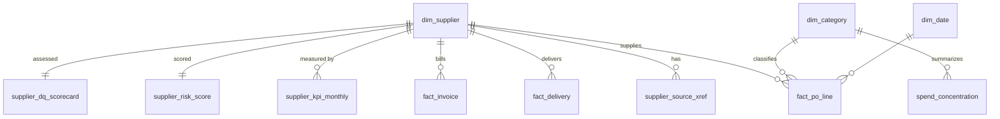

# Data model

All tables live in the `wizard` catalog. Bronze and silver keep source-system names and keys. Gold is keyed on the resolved `supplier_id`.

## Sources

| Source | Simulates | Entities | Delivery mode |
|---|---|---|---|
| SAP S/4 mock | ERP | `LFA1` vendor master, `LFB1` vendor/company code, `EKKO` PO header, `EKPO` PO item, `EKBE` PO history (goods receipts, invoice receipts), `RBKP` invoice header | CDC (Debezium → Redpanda → shipper) |
| Coupa mock | Procure-to-pay | `suppliers`, `purchase_orders`, `invoices`, `contracts` | REST, incremental by `updated_at` watermark |
| HICX mock | Supplier information management | supplier profiles, certifications, bank details, contacts | Weekly Excel/CSV export drop |
| Documents | Contract and compliance repository | contracts, ISO 9001/14001 certificates, W-9-style tax forms | File drop |
| USAspending.gov | Real procurement spend | federal contract awards by recipient (UEI, name, address, NAICS) | Bulk download snapshot |
| GLEIF | Real legal entity reference | LEI, legal name **in local language and script**, transliterated and other names, address, parent relationships | API lookups for in-scope suppliers |
| OFAC SDN | Real sanctions list | sanctioned entities and aliases (many transliterated from Cyrillic and Arabic) | Snapshot |
| SEC EDGAR | Real financial signals | company facts (revenue, net income, filings) | API snapshot for listed suppliers |
| ProZorro (Ukraine) | Regional ERP: Ukrainian operations | real supplier names in **Cyrillic**, EDRPOU company IDs, tender awards | Kaggle snapshot, replayed through a regional company code |
| Polish public tenders (BZP + TED) | Regional ERP: Polish operations | real contractor names with **Polish diacritics**, NIP/REGON IDs, awards | Kaggle snapshot, replayed through a regional company code |

## Multilingual suppliers

The enterprise has regional operations in **Poland** and **Ukraine**. Their SAP company codes store suppliers the way local buyers type them, while group-level systems (Coupa, HICX) store English or transliterated names. One supplier can therefore appear as:

| System | Name |
|---|---|
| SAP company code UA01 | `ТОВ "Нова Пошта"` |
| Coupa (group) | `Nova Poshta LLC` |
| HICX | `NOVA POSHTA, TOV` |
| GLEIF | legal name in Cyrillic + transliterated name |

Ground truth for cross-script pairs comes from two places: GLEIF records that carry both the local legal name and a transliterated name, and the generator, which writes known variants of each regional supplier into group systems.

Matching problems this adds:

- **Script:** Cyrillic ↔ Latin, with several transliteration standards (`Нова` → `Nova`, `Novа`, `Nowa`)
- **Legal forms in other languages:** `ТОВ`/`TOV` = `Sp. z o.o.` = `LLC` = `GmbH` = `Ltd`
- **Diacritics:** `Łódź` vs `Lodz`, `Spółka` vs `Spolka`
- **Translated vs transliterated names:** `Укрзалізниця` vs `Ukrzaliznytsia` vs `Ukrainian Railways`
- **National IDs:** EDRPOU (UA), NIP/REGON (PL), with country-specific format and checksum validation

The same multilingual matching is used for **sanctions screening**, since many OFAC aliases are transliterations.

## Candidate Kaggle datasets

Found on 2026-11-13. Contents and licences are **not yet verified** (this needs a Kaggle API token).

| Dataset | Intended role | Status |
|---|---|---|
| SAP DATASET (mustafakeser4) | Real SAP structures (`LFA1`, `EKKO`, `EKPO`, `RBKP`, `RSEG`) for the SAP mock | To verify |
| CUAD (Atticus Project) | Real commercial contracts plus expert clause labels for the document layer and extraction scoring | To verify (CC BY 4.0 at origin) |
| Amazon ML Challenge 2026 entity resolution | External benchmark for the matcher | To verify; internal use only if competition terms apply |
| World Bank Corporate Procurement Contract Awards | Real indirect spend with international vendor names | To verify |
| ProZorro, Polish public tenders | Multilingual regional suppliers | To verify |
| Company Documents Dataset (Northwind) | Invoice and PO PDFs | To verify |
| Procurement Invoice Fraud Dataset | Invoice-anomaly signal with labels | To verify |
| Supply Chain Datasets | Small Coupa-style source with planned/actual delivery | To verify |
| Olist | Real delivery-delay distributions for the generator | To verify (CC BY-NC-SA at origin) |

## Synthetic data and injected defects

The generator (`sources/generator/`) produces about 2,000 suppliers, 3 years of POs, deliveries and invoices, and roughly 500 documents. Part of the supplier base is seeded from real USAspending recipients, so names and addresses look real.

Defects are injected on purpose and **recorded in a ground-truth table**, so data-quality and entity-resolution results can be scored:

| Defect | Example | Detected by |
|---|---|---|
| Cross-system duplicates | `IBM Corp` (SAP) / `I.B.M.` (Coupa) / `INTERNATIONAL BUSINESS MACHINES CORPORATION` (USAspending) | Entity resolution |
| Within-system duplicates | Two SAP `LIFNR`s for one supplier, created years apart | Entity resolution |
| Name variants | Legal suffixes, abbreviations, typos, transliterations | Normalization + Splink |
| Cross-script variants | `ТОВ "Нова Пошта"` (SAP UA01) / `Nova Poshta LLC` (Coupa) / `Nowa Poszta` (bad transliteration) | Multilingual normalization + embeddings + LLM |
| Invalid national IDs | EDRPOU or NIP with a wrong check digit | Country-specific validation → DQ scorecard |
| Missing or invalid tax IDs | Blank, wrong format, wrong check digit | Expectations → DQ scorecard |
| Conflicting addresses | Different postcode in SAP vs HICX | Survivorship + DQ consistency |
| Delivery drift | A chosen set of suppliers whose on-time rate drops slowly over 9 months | Delivery KPIs |
| Expiring or expired certificates | ISO cert expired but supplier still active | Doc extraction → risk |
| Sanctions hits | Synthetic supplier alias close to an OFAC SDN entry | Sanctions screening |
| Late-arriving and out-of-order CDC | Update events before the insert event | `AUTO CDC` sequencing |
| Schema drift | Coupa adds a field mid-history | Auto Loader schema evolution |

## Bronze

One streaming table per source entity, all with these metadata columns:

| Column | Description |
|---|---|
| `_source` | `sap`, `coupa`, `hicx`, `docs`, `usaspending`, `gleif`, `ofac`, `sec` |
| `_file` | Landing file path |
| `_batch_id` | Shipper batch ID (joins to manifest) |
| `_ingested_at` | Auto Loader ingest timestamp |
| `_rescued_data` | Columns that didn't match the schema |

Examples: `bronze.sap_lfa1_cdc`, `bronze.sap_ekpo_cdc`, `bronze.coupa_suppliers`, `bronze.hicx_supplier_profiles`, `bronze.docs_binary`, `bronze.usaspending_awards`, `bronze.gleif_lei`, `bronze.ofac_sdn`.

## Silver

| Table | Grain | Notes |
|---|---|---|
| `silver.supplier_records` | one row per source supplier record | Union of SAP/Coupa/HICX/USAspending/GLEIF in a canonical schema: `source`, `source_id`, `legal_name`, `name_norm`, `tax_id`, `lei`, `duns_like`, `address_*`, `country`, `bank_account_hash`, `updated_at` |
| `silver.sap_vendor` | LIFNR, SCD2 | From `AUTO CDC` |
| `silver.purchase_order_line` | PO line | SAP `EKKO`+`EKPO` and Coupa POs, conformed |
| `silver.goods_receipt` | receipt event | From `EKBE` (movement type GR) and Coupa receipts |
| `silver.invoice` | invoice | `RBKP` and Coupa invoices |
| `silver.certification` | certificate | HICX metadata merged with document extraction |
| `silver.doc_chunks` | chunk | `doc_id`, `supplier_ref`, `page`, `chunk_id`, `text`, `doc_type` |
| `silver.doc_extractions` | document | Typed fields from `ai_query()` with JSON schema |
| `silver.sanctions_entities` | entity/alias | OFAC, exploded aliases |
| `silver._quarantine_*` | rejected row | Original row + `failed_rule` + `quarantined_at` |

## Entity resolution outputs

| Table | Description |
|---|---|
| `silver.er_candidate_pairs` | Blocked pairs with comparison vectors |
| `silver.er_scored_pairs` | Splink match probability per pair |
| `silver.er_llm_adjudications` | Middle-band pairs: model, prompt version, verdict, reason |
| `silver.er_review_queue` | Pairs waiting for a steward decision |
| `silver.er_clusters` | `source`, `source_id` → `cluster_id` |
| `gold.supplier_match_evidence` | Final links with score, evidence and method (`deterministic`, `probabilistic`, `llm`, `steward`) |
| `ops.er_eval` | Precision, recall and F1 against ground truth, per run |

## Gold

| Table | Grain | Key columns |
|---|---|---|
| `dim_supplier` | supplier (SCD2) | `supplier_id`, `legal_name`, `lei`, `tax_id` (masked), `country`, `parent_supplier_id`, `status`, `valid_from`, `valid_to`, `is_current` |
| `supplier_source_xref` | source record | `supplier_id`, `source`, `source_id`, `match_method`, `match_score` |
| `dim_category` | category | `category_id`, UNSPSC-style hierarchy |
| `fact_po_line` | PO line | `supplier_id`, `category_id`, `order_date`, `amount_usd`, `qty`, `promised_date`, `source`, `source_po_id` |
| `fact_delivery` | goods receipt | `supplier_id`, `po_line_id`, `promised_date`, `received_date`, `days_late`, `qty_received`, `qty_rejected` |
| `fact_invoice` | invoice | `supplier_id`, `invoice_date`, `amount_usd`, `payment_terms_days`, `paid_date` |
| `supplier_kpi_monthly` | supplier × month | `on_time_pct`, `avg_days_late`, `rejection_rate`, `spend_usd`, `on_time_trend_6m` (slope) |
| `supplier_risk_score` | supplier | `sanctions_score`, `financial_score`, `compliance_score` (cert expiry), `concentration_score`, `delivery_score`, `risk_score`, `risk_band`, `drivers` (array) |
| `spend_concentration` | category × period | `total_spend`, `supplier_count`, `hhi`, `top1_share`, `top3_share` |
| `supplier_dq_scorecard` | supplier | `completeness`, `validity`, `consistency`, `duplicate_count`, `issues` (array) |

### KPI definitions

| KPI | Definition |
|---|---|
| On-time delivery % | receipts with `received_date ≤ promised_date` ÷ all receipts in the period |
| Deterioration | negative slope of `on_time_pct` over the trailing 6 months and below 85% |
| Spend HHI | Σ(supplier share of category spend × 100)², 0–10,000 |
| Risk score | Weighted sum of sub-scores (weights in `ops.risk_weights`, versioned) |
| DQ completeness | Required fields filled ÷ required fields |
