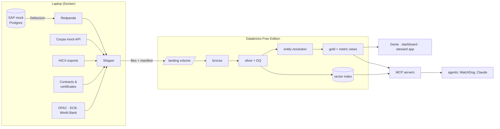

# Databricks Wizard: architecture write-up

Larkspur Foods is a fictional food manufacturer that buys from about 3,200 real-world suppliers through four company codes: US01, NL01, PL01 and UA01. Its supplier data is spread across the same systems most large companies have:

- an SAP ERP,
- Coupa for procure-to-pay,
- HICX for supplier management,
- a folder of contracts and certificates.

Each system holds its own copy of each supplier. Polish and Ukrainian buyers type names in their own scripts. Nobody can say with confidence how much the company spends with a supplier, whether that supplier is getting worse, or whether its certificate is still valid.

Databricks Wizard is the data foundation that answers those questions. It resolves every source record into one governed golden supplier. It then gives people (Genie, a dashboard, a steward app) and AI agents (three MCP servers) the same trusted, traceable data. It runs on Databricks Free Edition for ₹0.

This write-up explains the design and what changed along the way. The reference material is in [architecture.md](architecture.md), the [data model](data-model.md) and the [ADRs](adr/).

## 1. The shape of the system

A file arriving with its manifest starts one Lakeflow job. The job runs bronze, then silver, then entity resolution and the vector index sync in parallel, then gold, governance, the semantic layer and a health check. A change committed in the Postgres "SAP" reaches gold in a few minutes, with no manual step.

## 2. Decisions that shaped it

**Push, not pull** ([ADR 0002](adr/0002-hybrid-local-sources-push-landing.md)).
- Free Edition can't reach into a laptop, so a local shipper uploads micro-batches to a Unity Catalog volume. This is the landing-zone pattern enterprises use for on-prem sources.
- Every batch carries a manifest. The shipper writes it last and only then commits Kafka offsets. A crash can therefore re-send data but never lose it.
- Bronze reconciles each file against its manifest. That reconciliation is the first data-quality check.

**Real names, fictional company** ([ADR 0003](adr/0003-real-public-plus-synthetic-data.md)).
- Supplier identities come from public procurement data: the SAP demo vendor master, World Bank awards, Polish tenders with real NIP numbers, and Ukrainian ProZorro suppliers in Cyrillic. That gives the matcher real spelling variety.
- The generator plants the problems a real company has, and writes down every one in an answer key: duplicates, transliterations, ID typos, conflicting addresses, delivery drift, expired certificates and sanctions near-matches.
- Every quality claim in this project is therefore measured against known answers. None are eyeballed.
- Builds are deterministic: two runs produce byte-identical files.

**Entity resolution in layers** ([ADR 0004](adr/0004-entity-resolution-approach.md)).
- The layers run in order:
  1. normalization (legal forms in 5 languages, transliteration, a phonetic skeleton);
  2. deterministic tiers;
  3. a Splink model trained without labels, plus embedding neighbours;
  4. an LLM for the uncertain middle band;
  5. clustering with constraints.
- The most important lesson was that **the LLM made results worse until it was guarded**. Unguarded, it matched one record to several clusters and chained them together, which lowered F1. Treating "matches many" as ambiguity rather than identity fixed it. Refused links go to a steward queue.

**Models chosen by benchmark** ([ADR 0005](adr/0005-model-selection-by-benchmark.md)). There are four benchmarks: ER adjudication, name embeddings, document extraction and agent tool-calling. Each picked a different winner:

| Job | Model chosen | Why |
|---|---|---|
| ER adjudication | Qwen3-Next 80B | 0.92 accuracy, 0 false non-matches |
| Name embeddings | Qwen3 embedding 0.6B | the only one that does anything across scripts |
| Document extraction | Llama 4 Maverick | 0.999 field accuracy, 1.000 on scanned PDFs |
| Agent tool-calling | Qwen3-Next 80B | 12/12 correct, fastest |

Two findings mattered more than the model rankings:
- Maverick is the best extractor, but it often writes tool calls as plain text. So it is not used for agents.
- In the first agent run, every model failed the spend-concentration question. The fix was a missing governed tool, not a better model.

**MCP as the agent interface** ([ADR 0006](adr/0006-mcp-as-agent-interface.md)).
- Three MCP servers (analytics, knowledge, stewardship) run on one Databricks App. They mirror Intelligence WatchDog's split, so one agent can use both systems the same way.
- Tools return data plus provenance: the SQL, the tables and the document citations.
- Every call is audited under the caller's identity.
- Agents can *propose* steward decisions, but only a person can approve them, in the steward app.

**Governance in the catalog, not the app** ([ADR 0007](adr/0007-governance-model.md)).
- PII is masked by Unity Catalog column masks:
  - bank accounts;
  - national and tax IDs.
- Invoices are filtered by company code with a row filter.
- A health check fails the job if any PII-tagged column is unmasked.
- Every identity has the least access it needs:
  - CI deploys as its own service principal and can change code but not the identity jobs run under;
  - WatchDog has its own principal, which can only call the MCP app.

## 3. Results

| Area | Exit test | Result |
|---|---|---|
| Entity resolution | pairwise F1 vs the answer key | **0.965** overall, **0.966** Cyrillic–Latin (targets 0.95 / 0.85) |
| ER, outside our domain | Amazon ML Challenge sample (US + India), no tuning, no LLM | F1 0.829 (US 0.898, India 0.717) |
| Data quality | planted single-source defects found | all |
| Delivery drift | market-adjusted deterioration rule | 6 of 10 testable planted suppliers, plus 9 real deteriorations in the untouched SAP history |
| Business questions | Genie answers the 4 core questions, scored against gold | 4/4 |
| Documents | cited answers / planted metadata mismatches | 40/40 / 26 of 26, no false positives |
| Agents | 12 business questions over MCP | 12/12 |
| Governance | masks, row filter, CI deploy, lineage end to end | all pass |

**Lineage is end to end.**
- Unity Catalog traces every metric view and the Supplier 360 back to SAP, Coupa and HICX bronze tables.
- For individual rows, sampled invoices are traced further: gold, then silver, then bronze, then the landing file, then the shipper manifest that declared it.
- Unity Catalog doesn't record Auto Loader files as upstream of bronze, so the data itself carries that last hop.

## 4. Things that went wrong, and what they taught

- **The answer key was wrong before the matcher was.** SAP training copies of the same vendor were grouped inconsistently, so no matcher could score well. Fixing the key without touching the data (checksums verified) was worth more than any tuning.
- **A planted problem nobody could detect isn't a test.** The first delivery-drift storyline sat inside real-data noise: the best rule found 4 suppliers and raised 25 false alarms. The drift was redone at a realistic size, and the rule was made market-adjusted, because the market on-time rate swings between 31% and 77% month to month.
- **Name-only sanctions screening alerts too often.** It raised 80 alerts for 6 planted near-matches. Adding OFAC addresses showed that 55 of the 80 had a country conflict. Those can be auto-cleared when the name isn't near-exact, and an alert is never shown as a finding.
- **Free Edition limits are design inputs.**
  - Tables per schema: every pipeline table also creates a hidden materialization table, so it counts twice against the 100-table limit.
  - One Vector Search endpoint.
  - Apps stop after 24 hours.
  - A daily compute quota.
  - No account groups, so Unity Catalog can't grant to groups.

  Each limit has a documented workaround in [architecture §9](architecture.md#9-platform-constraints).
- **The bundle permissions trap.** Declaring `permissions` in an Asset Bundle makes the deployer the owner of every job and pipeline, and only an admin may do that. CI failed until the bundle stopped declaring them. Access is now granted once by script.

## 5. What production would change

- Real connectors in place of the shipper: Lakeflow Connect or Debezium into cloud storage.
- Account groups synced from the identity provider, with grants given to groups.
- Several Vector Search endpoints and always-on apps.
- GLEIF and SEC enrichment, which are scoped but not built here.
- Steward decisions fed back as labels, so the matcher learns from its review queue.
- Sanctions screening with a licensed provider. OFAC name matching is a demo of the workflow, not a compliance control.
